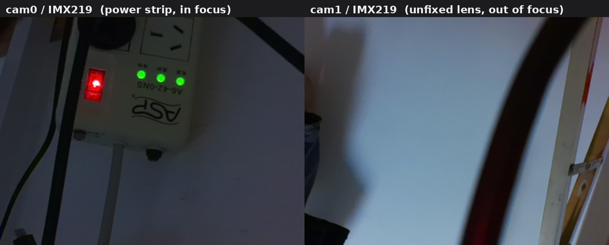
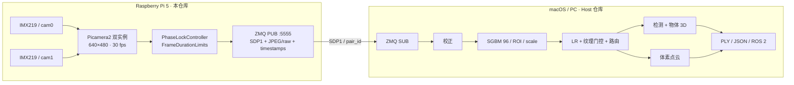

# Pi 5 Stereo Perception — Edge

> 面向机器人感知的双 IMX219 采集端：双实例采集、时间戳相位锁定、ZMQ 推流与无损录制。




这是**双仓库双目感知系统**的边缘端（Edge）。主机端负责校正、SGBM、点云、物体 3D 与 ROS 2 输出：

- **Host / PC 端**：[`pi5-stereo-perception-host`](https://github.com/zmmmawzfl/pi5-stereo-perception-host)

两端通过 ZMQ + `SDP1` 协议通信；本仓库**不做** SGBM、点云或 ROS 2。

---

## 1. 它解决什么问题

两个 CSI 相机各自能出图，不等于能拼成立体对：

- 两台相机的启动相位是随机的，直接配对会差半帧到两帧；
- 简单按“先收到左、再收到右”配对，会在掉帧时错位；
- 时间戳差很小也不代表曝光同步，最终要看运动场景的 SGBM 抖动。

本仓库把这三件事分开处理：

1. **按 `pair_id` 配对**，不靠到达顺序；
2. **P 环调从动相机的 `FrameDurationLimits`**，把 `SensorTimestamp` 差压到亚毫秒；
3. **把时间戳、帧、同步状态一起送出去**，让主机端能判断这一对能不能用。

## 2. 系统位置



## 3. 功能

- **双 IMX219 采集**：Picamera2 两个实例，`buffer_count>=3`，640×480@30 fps；
- **时间戳同步**：P 控制环微调从动相机帧周期，不需要外部触发线；
- **配对与重组**：`pair_id` + 左右 `SensorTimestamp`，Host 端按 id 重组；
- **ZMQ 推流**：默认 JPEG 帧 + JSON header（可切 `raw_bgr8`），帧端口 `5555`，时间戳旁路 `5556`；
- **无损录制**：PNG 序列 + `pairs.jsonl`，用于离线标定/复算；
- **第一天基线**：时间戳差中位数/IQR、P 环前后对比、坏对统计；
- **合成/回放后端**：没有相机也能跑通采集、配对、推流、统计链路。

## 4. 当前状态

| 能力 | 状态 | 说明 |
|---|---|---|
| 双 IMX219 枚举 | ✅ 实测 | `rpicam-hello` 看到 cam0/cam1 |
| 单相机出图 | ✅ 实测 | `rpicam-still` 640×480 |
| 双实例同时采集 | ✅ 实测 | `Picamera2Backend` 连续采集成对 |
| 时间戳 P 环 | ✅ 实测 | 未控制 52.8 ms → 200 帧后 ~0.56 ms |
| ZMQ 推流 / 录制 | ⚠️ 代码 + 回环验证 | 实机推流吞吐/热稳定性待测 |
| 刚性固定 / 基线 | ❌ 待做 | 当前只是插上，未做支架 |
| 真实标定 | ❌ 待做 | 固定在 Host 端完成，本仓库只采图 |
| 运动/曝光同步 | ❌ 未测 | 时间戳对齐 ≠ 曝光同步 |

**20 个单元测试通过**：

```bash
.venv/bin/python -m unittest discover -s tests -t .
```

## 5. 硬件与环境

| 项 | 建议 |
|---|---|
| 主机 | Raspberry Pi 5，8 GB 优先（4 GB 推流时余量偏紧） |
| 相机 | 2× IMX219，CSI 排线注意 cam0/cam1 方向 |
| 电源 | 官方 27 W USB-C PD |
| 散热 | 主动风扇 + 散热片（采集 + 编码会持续占 CPU） |
| 系统 | Raspberry Pi OS 64-bit Bookworm |
| 网络 | 千兆网线直连 PC 或交换机，避免 WiFi |

`/boot/firmware/config.txt` 中需要两个相机 overlay：

```ini
camera_auto_detect=1
dtoverlay=imx219,cam0
dtoverlay=imx219,cam1
```

改完重启，再跑 `rpicam-hello --list-cameras`。两个相机都报 `Rotation=180`；如果画面方向不合适，采集/校正前统一转 180°。

## 6. 快速开始

### 6.1 安装

```bash
git clone https://github.com/zmmmawzfl/pi5-stereo-perception-edge.git
cd pi5-stereo-perception-edge

sudo apt install -y python3-opencv python3-picamera2 python3-zmq
python3 -m venv --system-site-packages .venv
.venv/bin/pip install -r requirements.txt
```

### 6.2 无相机自检（合成后端）

```bash
# 消息协议 + 同步环测试
.venv/bin/python -m unittest discover -s tests -t .

# 合成时间戳基线
.venv/bin/python -m pi.tools.timestamp_baseline \
    --backend synthetic --frames 100 --out runs/day1_synthetic.json

# 录一段回放数据给 Host 端
.venv/bin/python -m pi.tools.record_pairs \
    --backend synthetic --frames 6 --out data/recordings/synth6
```

### 6.3 真实相机

```bash
rpicam-hello --list-cameras

# 先确认两张图都能出；cam1 需要手动调焦
rpicam-still --camera 0 --width 640 --height 480 --nopreview -t 500 -o /tmp/cam0.jpg
rpicam-still --camera 1 --width 640 --height 480 --nopreview -t 500 -o /tmp/cam1.jpg
```

**固定前只验证“能出图/能配对”，不要采标定板。** 没有刚性支架时，碰一下基线就变了。

### 6.4 时间戳基线

```bash
# 不控制：记录两台相机的原始相位差
.venv/bin/python -m pi.tools.timestamp_baseline \
    --frames 100 --out runs/day1_raw.json

# 开 P 环：对比收敛前后
.venv/bin/python -m pi.tools.timestamp_baseline \
    --frames 200 --with-control --out runs/day1_locked.json
```

### 6.5 启动采集服务

先启动 Host 端接收器，再启动 Pi（ZMQ PUB 不保留历史，慢加入会丢首帧）：

```bash
# Pi
.venv/bin/python -m pi.service \
    --config configs/pi.yaml \
    --record-root data/recordings/run1 \
    --duration 30

# Host（另一个仓库/机器）
python -m pc.receive.record_pairs \
    --endpoint tcp://<PI_IP>:5555 \
    --out data/recordings/day1 --max-pairs 100
```

服务启动阶段会丢弃尚未对齐的帧（`dropped`），等 P 环收敛后开始稳定出对。

## 7. 数据协议

```text
MAGIC "SDP1" | header_len: uint32 LE | header: JSON | payload: JPEG/raw
```

关键字段：

| 字段 | 含义 |
|---|---|
| `pair_id` | 左右帧的配对键，绝不按到达顺序拼 |
| `left.sensor_ts_ns` / `right.sensor_ts_ns` | 两台相机的 `SensorTimestamp` |
| `seq` | 本端采集序号 |
| `width` / `height` / `enc` | 图像尺寸与实际载荷编码 |

端口：帧 `5555`，时间戳旁路 `5556`。完整契约见 [docs/interfaces.md](docs/interfaces.md)。

## 8. 目录

```text
raspberry-pi/
├── pi/
│   ├── capture/        # Picamera2 / synthetic / replay
│   ├── sync/           # PhaseLockController + 仿真
│   ├── stream/         # ZMQ PUB / 文件落盘 / Tee
│   ├── service.py      # 采集 → 同步 → 推流/录制
│   └── tools/          # 时间戳基线、录制工具
├── shared/             # SDP1、配置、统计、合成场景、录制格式
├── configs/            # default / pi
├── tests/              # 20 个 Pi 侧 unittest
└── docs/               # 第一天、接口、联调、相机检查
```

## 9. 实测记录

2026-11-04，Pi 5 + 2× IMX219，640×480@30 fps，未刚性固定：

| 项 | 结果 |
|---|---|
| 未控制时间戳差 | `median 52.7650 ms`，`IQR 0.0025`，`std 0.0043` |
| P 环 200 帧最后 10 帧 | `1.07 → 0.56 ms` |
| P 环最后 50 帧 | `median 3.622 ms`，`min 0.558`，`max 10.793` |
| 收敛时间 | 约 150–200 帧（5–7 s @30 fps） |
| 服务收敛期 | 前 ~131 对判坏对丢弃，之后稳定 |

> 这些是**未固定**状态的数字。装上支架、调好焦后必须重测，不能直接当验收值。

## 10. 已知限制 / 路线图

**限制**

- 相机未刚性固定，基线长度未知，标定结果不可复现；
- `cam1` 当前失焦，需要先调镜头；
- P 环只对齐**时间戳**，不保证曝光起始时刻完全一致；
- 推流默认 JPEG over ZMQ（可 `raw_bgr8`），不是 H.264/WebRTC；压缩伪影需在 Host 端量化；
- 未做长时间满载、散热降频、千兆网吞吐测试。

**路线图**

1. 刚性支架 + 两个模组锁死 + `cam1` 调焦；
2. 固定后重测 raw / controlled 时间戳分布；
3. 采 15–25 对棋盘格，交给 Host 端标定；
4. 量化推流压缩对 SGBM 的影响；
5. 用慢速运动纹理板测同步残差的实际几何影响。

## 11. 文档

| 内容 | 位置 |
|---|---|
| 第一天实机清单 | [docs/day1.md](docs/day1.md) |
| 相机检查记录 | [docs/camera_check.md](docs/camera_check.md) |
| 协议/坐标约定 | [docs/interfaces.md](docs/interfaces.md) |
| Pi↔PC 联调排障 | [docs/runbook.md](docs/runbook.md) |
| Host 端（SGBM/点云/ROS 2） | [pi5-stereo-perception-host](https://github.com/zmmmawzfl/pi5-stereo-perception-host) |

## 12. 说明

- 本仓库是**边缘采集端**，不要在 Pi 上跑 SGBM/点云；
- 640×640 不是 IMX219 原生模式；raw BGR 30fps 约 590 Mbps，默认仍用 JPEG。
  链路预算与建议见 Host 仓库 `docs/transport.md`。
- `.venv` 是 Linux/aarch64 的，不要复制到 Mac；
- 模型权重不在本仓库；Host 端的模型许可见其 README。
