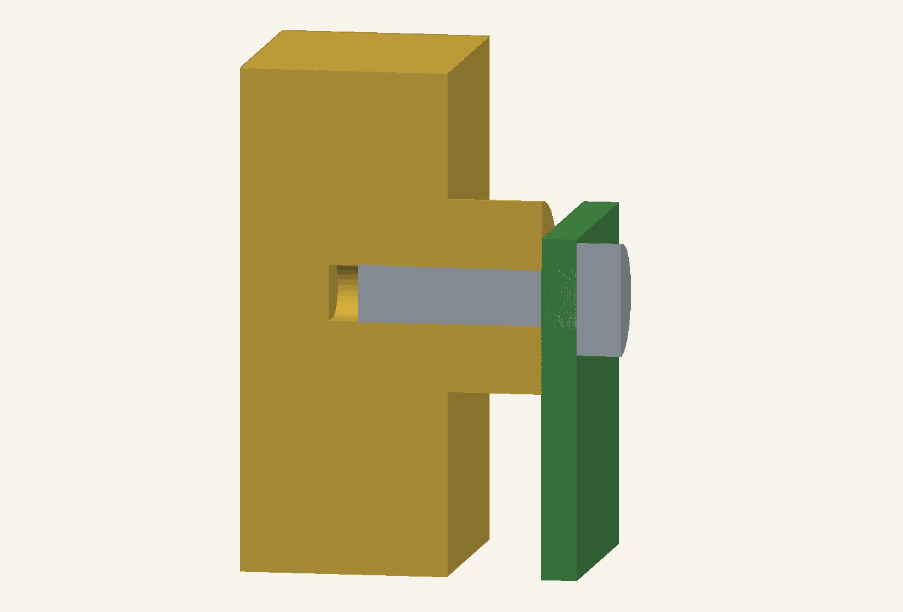
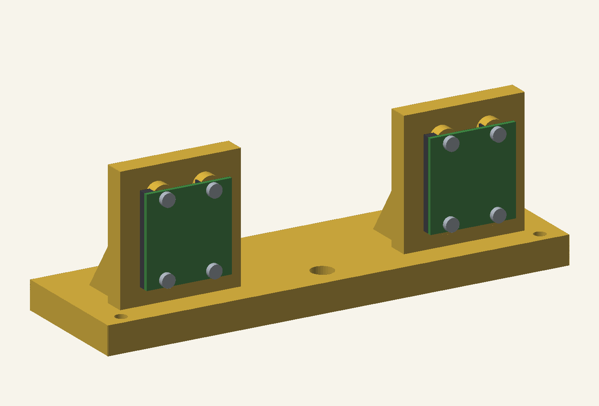

# 双目 IMX219 基线支架


参数化基线支架，默认 80 mm，可导出 60/80/100 mm 三种 STL。它**不是万能外壳**：
孔位、板厚、镜头中心偏移都要按你手头的模组实测后改参数。

当前版本（v4，2026-11-21）：板由 4 个 Ø6.5 立柱**架空 1.0 mm**，
M2×8 机牙螺钉从正面穿过 PCB 与立柱，拧进**立板背面的六角螺母**，可反复拆装。

---

## 1. 先选基线

基线 `B` 是**两个镜头光心的距离**，不是两块 PCB 的边缘距离。它同时决定：

- 近端极限：`Z_min ≈ f·B / numDisparities`；
- 远端精度：一个视差像素对应的深度变化 `ΔZ ≈ Z² / (f·B)`。

按当前项目参数 `f≈531 px`、`numDisparities=96`：

| 基线 B | 近端极限 @96 | 近端 @128 | 1 m 处每像素 | 1.5 m 处每像素 | 2 m 处每像素 |
|---:|---:|---:|---:|---:|---:|
| 60 mm | 0.33 m | 0.25 m | 31 mm | 71 mm | 126 mm |
| **80 mm** | **0.44 m** | **0.33 m** | **24 mm** | **53 mm** | **94 mm** |
| 100 mm | 0.55 m | 0.42 m | 19 mm | 42 mm | 75 mm |
| 120 mm | 0.66 m | 0.50 m | 16 mm | 35 mm | 63 mm |

> “每像素”是单个整数视差对应的深度变化；实际物体中心取中位数/多像素，
> 误差会小得多，不是最终精度指标。

| 用途 | 基线 | 说明 |
|---|---:|---|
| 桌面抓取/近距 0.3–1.0 m | **60 mm** | 96 视差下近端 0.33 m；要更稳就 128 |
| 通用室内 0.4–2 m（推荐默认） | **80 mm** | 近端 0.44 m；和现有 83 mm 标定接近 |
| 1–3 m 导航/物体 | **100 mm** | 远端更好，近端 0.55 m |
| 2–5 m 走廊/室外 | **120 mm** | 不适合抓取，近端 0.66 m |

**如果必须覆盖 0.3 m**：选 60 mm，并把 `numDisparities` 提到 128；
80 mm + 96 视差在 0.3 m 处视差约 142 px，已经超出 96，测不到。

---

## 2. 打印前必须量的尺寸

默认值是 DC-IMX219-V1 的常见值，**用卡尺量你的板**：

| 参数 | 默认 | 怎么量 / 说明 |
|---|---:|---|
| 板宽 × 高 `board_w` × `board_h` | 24 × 25 mm | PCB 外形；25 mm 那条边要放 21.86 mm 宽的排线座 |
| 左右孔距 `hole_dx` | 13.25 mm | 两孔中心（水平）。立板内是 ±0.6 长圆孔，**13.0–13.6 都能装** |
| 上下孔距 `hole_dy` | 21 mm | 两孔中心（竖直） |
| 板厚 `board_t` | 1.5 mm | 只影响螺钉长度，不影响导出几何 |
| 架空高度 `standoff_h` | 1.0 mm | **不是**给排线座让位（座在正面）；见 §4 |
| 螺母槽 `nut_af` / `nut_h` | 4.3 / 1.9 mm | 卡尺量六角**对边**（不是对角）= 4.0 + 0.3 间隙；厚 1.6 + 0.3 |
| 镜头中心偏移 `lens_dx/lens_dz` | 0 / 0 | 镜头**光心**相对 PCB 中心的偏移 |

镜头一般不在 PCB 正中心。量“镜头外圆中心”到板边，把偏移填进 `lens_dx/lens_dz`；
否则实际基线会和你以为的差 1–3 mm。

> **DC-IMX219-V1 图纸**（用户提供）：板 25 × 24 mm、孔距 21 × 13.6（另一组 13.5）、孔径 Ø2.2、
> 排线座宽 21.86 mm。手上这块实测 **13.0 × 21**，与图纸差 0.5 mm，
> 所以 `hole_dx` 取 13.25，并把**立板内的过孔**做成 X 向 ±0.6 长圆孔（3.6 mm 宽）；
> 立柱顶面不开长圆孔，保持完整 Ø6.5 支撑环（见 §4）。

---

## 3. 文件

| 文件 | 用途 |
|---|---|
| `camera_mount.scad` | 参数化源文件，改 `baseline`/孔位后重新导出 |
| `stl/camera_mount_b60.stl` | 60 mm 基线 |
| `stl/camera_mount_b80.stl` | 80 mm 基线（默认） |
| `stl/camera_mount_b100.stl` | 100 mm 基线 |

```bash
openscad -o stl/camera_mount_b80.stl -D baseline=80 camera_mount.scad
```

三份 STL 均为单一闭合网格（3944 三角面），包围盒 X 110/130/150、Y 38、Z 44 mm。

---

## 4. 夹紧结构（为什么是这样）



**图怎么读**：右边是镜头那一面（正面、朝外），左边是背面（螺母埋在立板里）；灰色 = 钢、绿 = PCB、
土黄（带斜线）= 打印件实心、纯白 = 空气。图上 ①–⑤ 对应下面的条目；底部尺寸链是这条夹紧链的厚度，
**1.5 + 1.5 + 1.0 = 4.0 mm 就是螺钉头底面到立板面的距离**，M2×8 正好吃进螺母 1.45 mm。
右下小图是沿螺丝轴看下去：立柱环 Ø6.5 的范围比那条 3.6 mm 长的孔大，压力才落在实心环上。
重新生成：`python3 hardware/make_section_figure.py`（数值是手写常量，改设计要一起改）。

一块板 4 颗螺钉，每颗的受力顺序是：

**M2 螺钉头 Ø3.8 → PCB 1.5 → 立柱顶面 Ø6.5 环 → 立板 4.05 → 背面六角螺母 1.6**

- **PCB 被夹住，不靠塑料螺纹吃劲**：所以能反复拆装，8 颗手拧 0.05–0.1 N·m 足够
  （单颗约 120–250 N 预紧），**别用电动批**；
- **立柱内是 Ø2.8 圆孔，不是长圆孔**：PCB 背面压在完整的一圈 Ø6.5 环上（环宽 1.85 mm），
  螺钉头压在环上而不是压在空档上——拧紧时板不会陷进槽里，FR4 不会被压裂，两个镜头才不会失去共面；
- **架空 1.0 mm 的唯一作用**：把板抬过立板里那条 3.6 mm 宽的 Ø2.4 长圆孔
  （它负责吸收 13.0–13.6 的孔距公差）。板直接贴平就会跨在这条槽上，一压就塌。**不是**给排线座让位；
- **立板内 Ø2.4 过孔顶部带 45° 泪滴**：专门对付 FDM 水平孔顶部塌陷；打印后偏紧就用 2.5 mm 钻头**手拧**一下，别用电钻；
- **螺母槽开在立板背面**：对边 4.3、深 1.9（螺母 4.0 × 1.6），`$fn=6` 六角一块平顶朝上，FDM 最友好；
  螺母**不用胶**——拧螺钉时被拉到槽底前壁上，越拧越紧；
- **立板厚 6.0 mm**：螺母槽后墙 4.05 mm；再薄螺母槽会顶穿，再厚就得换 M2×10；
- **底板 1/4-20 六角螺母槽**：螺母从底面放入，螺钉从三脚架穿上来；槽 13 mm 对角、深 5.6 mm，
  按你手头的螺母改 `tripod_trap_d`/`tripod_trap_h`。

### 螺钉长度（`standoff_h = 1.0`、`board_t = 1.5`）

PCB 正面在 `y = +2.5`，立板背面在 `y = -6.0`，螺母槽从 `-4.05` 到 `-6.0`：

| 螺钉 | 尖端 y | 吃螺母 | 结论 |
|---|---:|---:|---|
| **M2×8** | **-5.50** | **1.45 / 1.6** | **推荐**：约 4 牙，尖端停在槽里不出背面 |
| M2×10 | -7.50 | 1.6（满） | 从立板背面**露出 1.5 mm** |
| M2×6 | -3.50 | 0 | 根本到不了螺母 |

### 排线方向（这块板的元件全在正面）

你的模组**所有元件（含 15 pin 排线座，宽 21.86）都在正面，背面是空板**。
所以板**竖装**（24 宽 × 25 高）：21 mm 那组孔距在竖直方向，排线座贴在某一条 **25 mm 竖边**上，
两块板**镜像**安装，让两条排线分别朝左右外侧走，不进入两台相机之间的 56 mm 空隙（会挡 160° 视场）。

> **装之前做一次干涉检查**：螺钉头内缘距板边 3.475 mm（孔心距边 5.375 − 1.9），
> 排线座本体从板边向内约 2.7–3.7 mm。拿一颗 M2 放进孔里比一下：若螺钉头蹭到排线座，
> 换 Ø3.5 的薄头/盘头，或在排线座那一侧垫 0.3–0.5 mm 薄垫片（只垫那一侧会让两镜头不共面，慎用）。

---

## 5. Snapmaker Artisan 打印设置

打印方向就是模型方向：**底板贴床、两块立板竖直朝上**（总高 44 mm）。
不要躺倒、不要侧放——躺倒会把立柱和螺母槽全变成悬垂。

| 项 | 值 |
|---|---|
| 层高 | 0.2 mm（首层 0.24） |
| 壁 | 4 圈（1.6 mm） |
| 填充 | 40%，grid / gyroid |
| 顶/底 | 5 层 |
| 温度 | PETG 240 / 80，风扇 50%（拆支撑段可降到 30%） |
| 速度 | 外墙 40 mm/s，支撑界面 20 mm/s |

**唯一必须加支撑的地方**：底板中央 1/4-20 螺母槽的顶盖——13 mm 对角空腔，顶面要跨 11 mm，
不加支撑会塌（Luban 开“生成支撑”+“允许支撑落在模型上”，打完从底面掏出来）。

**不要加支撑的地方**：

- 8 个 Ø6.5 立柱：`standoff_h` 只有 1.0 mm，立柱是立在立板正面上的矮圆柱，**没有悬垂**；
- 8 个 M2 螺母槽内部：顶只有 4.3 mm 宽，是短桥接，切片机会自己桥过去。
  硬塞支撑的话打完务必用镊子+美工刀清干净，否则螺母放不平、螺钉会斜着吃劲
  （槽顶轻微下垂不影响受力，螺母贴的是槽底前壁）。

打印后处理：拆支撑 → 2.5 mm 钻头手拧通 8 个 Ø2.4 孔 → 8 颗螺母逐个试塞
（能进、轻推不掉最好；松了就 `nut_af = 4.2` 重打）→ 再装板。

---

## 6. 装配顺序



1. **先塞螺母**：8 颗 M2 螺母从立板背面按六角方向放进槽里，应能自由落入、不晃。
   放不进就修槽口的支撑痕迹；太松就重打，或用一点点热熔胶点住（别用强力胶，以后拆不掉）；
2. 板竖装、镜头朝 +Y，排线座贴外侧竖边，四孔对准 4 个 Ø6.5 立柱；
   先把板放到立柱上、不上螺钉，确认排线座与螺钉头不打架（见 §4 的干涉检查）；
3. 螺钉从正面穿 PCB，**先拧对角两颗**，只带到“板贴住立柱、螺母被拉到位”，再拧另外两颗；
   最后统一加力——**手感是“到底即停”**（约 0.05–0.1 N·m），M2 拧过头会把螺母槽底压塌；
4. 拧紧后量两镜头光心距，应等于 `baseline`；差 > 0.3 mm 通常是立柱顶面有毛刺或板框没坐正；
5. 两块板尽量共面、光轴平行；先轻拧，确认画面水平再锁紧；**必须重新标定**，不能沿用旧参数；
6. 拆的时候先把螺丝退半圈再整体退，别用螺丝刀翘板；螺母可能跟着螺钉出来，正着塞回去即可。

---

## 7. 版本沿革与设计边界

| 版本 | 日期 | 做法 | 问题 |
|---|---|---|---|
| v1 | 2026-11-21 早 | 4 个 Ø2.2 通孔 | 板浮在立板前，**螺丝没有咬合对象** |
| v2 | 2026-11-21 午 | M2 自攻盲孔 | 能拧住，但拆几次就滑牙 |
| v3 | 2026-11-21 晚 | M2 机牙 + 背面螺母，架空 3.2 | 当时误以为排线座在背面；架空过高、悬垂多 |
| **v4** | **2026-11-21** | **M2 机牙 + 背面螺母，架空 1.0 + M2×8** | **当前版本，旧 STL 请勿再打印** |

设计边界：

- 单件打印的起点模型，不是经过强度/公差验证的量产件；
- 模组孔位不是 13×21 就改参数重新导出，别硬拧；
- 80 mm 是“通用室内”折中；近距抓取优先 60 mm，远距导航优先 100–120 mm；
- 3D 打印件有蠕变，长期使用建议加金属加强板，或改成铝型材 + 打印转接件；
- PETG 优先（抗蠕变、比 PLA 刚），不要用 TPU；80 mm 版外形约 130 × 38 × 44 mm，体积约 51 cm³，
  PETG 实心约 64 g，40% 填充更轻。
