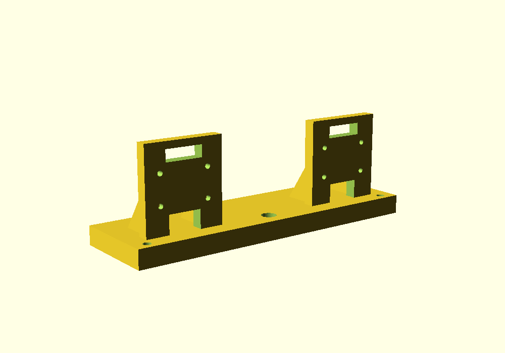

# 双目 IMX219 基线支架



这是给两块 IMX219 用的**参数化基线支架**，默认 80 mm，可导出 60/80/100 mm
三种 STL。它不是“万能外壳”：板子孔位、镜头中心偏移、排线方向都要按你
手头的模组实测后改参数。

## 1. 先选基线

基线 `B` 是**两个镜头光心的距离**，不是两块 PCB 的边缘距离。它同时决定：

- 近端极限：`Z_min ≈ f·B / numDisparities`；
- 远端精度：一个视差像素对应的深度变化 `ΔZ ≈ Z² / (f·B)`。

按当前项目参数 `f≈531 px`、`numDisparities=96`：

| 基线 B | 近端极限 @96 | 近端 @128 | 1 m 处每像素 | 1.5 m 处每像素 | 2 m 处每像素 |
|---:|---:|---:|---:|---:|---:|
| 60 mm | 0.33 m | 0.25 m | 31 mm | 71 mm | 126 mm |
| **80 mm** | **0.44 m** | **0.33 m** | **24 mm** | **53 mm** | **94 mm** |
| 100 mm | 0.55 m | 0.42 m | 19 mm | 42 mm | 75 mm |
| 120 mm | 0.66 m | 0.50 m | 16 mm | 35 mm | 63 mm |

> “每像素”是单个整数视差对应的深度变化；实际物体中心取中位数/多像素，
> 误差会小很多，不是最终精度指标。

建议：

| 用途 | 基线 | 说明 |
|---|---:|---|
| 桌面抓取/近距 0.3–1.0 m | **60 mm** | 96 视差下近端 0.33 m；要更稳就 128 |
| 通用室内 0.4–2 m（推荐默认） | **80 mm** | 近端 0.44 m；和现有 83 mm 标定接近 |
| 1–3 m 导航/物体 | **100 mm** | 远端更好，近端 0.55 m |
| 2–5 m 走廊/室外 | **120 mm** | 不适合抓取，近端 0.66 m |

**如果必须覆盖 0.3 m**：选 60 mm，并把 `numDisparities` 提到 128；
80 mm + 96 视差在 0.3 m 处视差约 142 px，已经超出 96，测不到。

## 2. 打印前必须量的尺寸

默认值只是常见值，**用卡尺量你的板**：

| 参数 | 默认 | 怎么量 |
|---|---:|---|
| 板宽/高 | 25 × 24 mm | PCB 外形 |
| 左右孔距 `hole_dx` | 21 mm | 两孔中心 |
| 上下孔距 `hole_dy` | 12.5 mm | 两孔中心 |
| 孔径 `hole_d` | 2.2 mm | M2 通孔 |
| 镜头中心偏移 `lens_dx/lens_dz` | 0 / 0 | 镜头光心相对 PCB 中心 |
| 板厚 `board_t` | 1.6 mm | 不影响孔位，但影响螺丝长度 |

镜头一般不在 PCB 的正中心。用卡尺量“镜头外圆中心”到板边，再把偏移填进
`lens_dx/lens_dz`；否则打印出来的实际基线会和你以为的差 1–3 mm。

## 3. 文件

| 文件 | 用途 |
|---|---|
| `camera_mount.scad` | 参数化源文件，改 `baseline`/孔位后重新导出 |
| `stl/camera_mount_b60.stl` | 60 mm 基线 |
| `stl/camera_mount_b80.stl` | 80 mm 基线（默认） |
| `stl/camera_mount_b100.stl` | 100 mm 基线 |

重新导出：

```bash
openscad -o camera_mount_b80.stl -D baseline=80 camera_mount.scad
```

## 4. 打印与装配

- 材料：**PETG** 优先（抗蠕变、刚性比 PLA 好）；不要用 TPU；
- 80 mm 版本外形约 130 × 38 × 44 mm，体积约 51 cm³，PETG 实心约 65 g；40% 填充会更轻；
- 0.2 mm 层高、4 圈壁、40% 填充；底板贴床，立板朝上；底部三脚架槽需要一小段桥接，留好冷却；
- 螺丝孔轴是水平的，孔顶会有桥接；怕堵就打印后用 2.2 mm 钻头手拧通一下；
- M2×8 或 M2×10 螺丝 + 螺母/热熔铜螺母；不要只靠自攻牙；
- 1/4-20 三脚架是**底部平贴的六角螺母槽**：螺母从底面放入，螺钉从三脚架穿上来；槽 13 mm 对角、深 5.6 mm，按你手头的螺母改 `tripod_trap_d` / `tripod_trap_h`；
- 摄像头板装在立板**前面**（镜头朝 +Y），排线从中间槽向下走；
- 装好后用卡尺量两镜头中心距，填进标定的 `baseline`；**必须重新标定**，不能沿用旧参数；
- 两块板尽量共面、光轴平行；先轻拧，确认画面水平再锁紧。

## 5. 设计边界

- 这是单件打印的起点模型，不是经过强度/公差验证的量产件；
- 如果你的模组孔位不是 21×12.5，改参数重新导出，不要硬拧；
- 80 mm 是“通用室内”折中；近距抓取优先 60 mm，远距导航优先 100–120 mm；
- 3D 打印件有蠕变，长期使用建议加金属加强板或改用铝型材+打印转接件。
