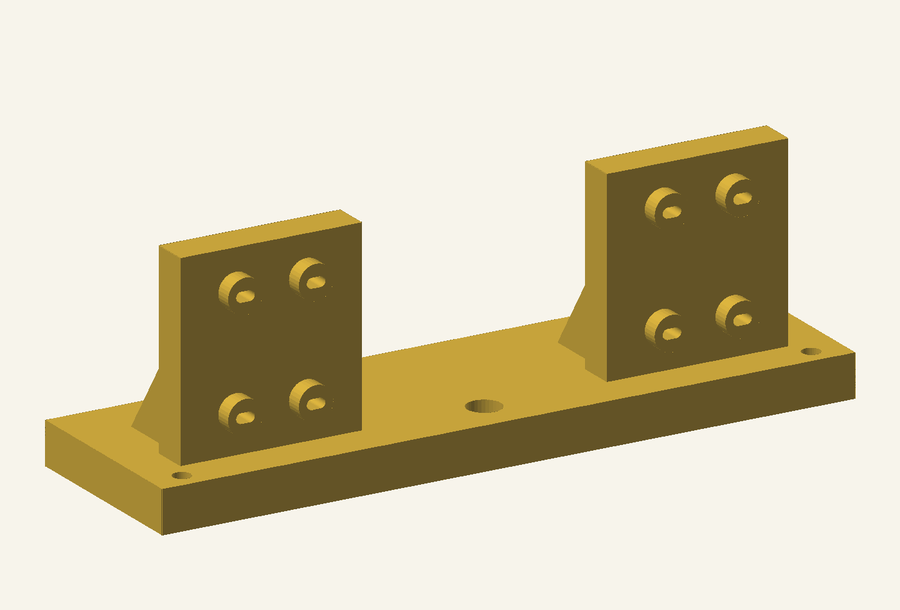

# 双目 IMX219 基线支架



这是给两块 IMX219 用的**参数化基线支架**，默认 80 mm，可导出 60/80/100 mm
三种 STL。它不是“万能外壳”：板子孔位、镜头中心偏移、排线方向都要按你
手头的模组实测后改参数。

## 1. 先选基线

基线 `B` 是**两个镜头光心的距离**，不是两块 PCB 的边缘距离。它同时决定：

- 近端极限：`Z_min ≈ f·B / numDisparities`；
- 远端精度：一个视差像素对应的深度变化 `ΔZ ≈ Z² / (f·B)`。

按当前项目参数 `f≈531 px`、`numDisparities=96`：

| 基线 B | 近端极限 @96 | 近端 @128 | 1 m 处每像素 | 1.5 m 处每像素 | 2 m 处每像素 |
|---:|---:|---:|---:|---:|---:|
| 60 mm | 0.33 m | 0.25 m | 31 mm | 71 mm | 126 mm |
| **80 mm** | **0.44 m** | **0.33 m** | **24 mm** | **53 mm** | **94 mm** |
| 100 mm | 0.55 m | 0.42 m | 19 mm | 42 mm | 75 mm |
| 120 mm | 0.66 m | 0.50 m | 16 mm | 35 mm | 63 mm |

> “每像素”是单个整数视差对应的深度变化；实际物体中心取中位数/多像素，
> 误差会小很多，不是最终精度指标。

建议：

| 用途 | 基线 | 说明 |
|---|---:|---|
| 桌面抓取/近距 0.3–1.0 m | **60 mm** | 96 视差下近端 0.33 m；要更稳就 128 |
| 通用室内 0.4–2 m（推荐默认） | **80 mm** | 近端 0.44 m；和现有 83 mm 标定接近 |
| 1–3 m 导航/物体 | **100 mm** | 远端更好，近端 0.55 m |
| 2–5 m 走廊/室外 | **120 mm** | 不适合抓取，近端 0.66 m |

**如果必须覆盖 0.3 m**：选 60 mm，并把 `numDisparities` 提到 128；
80 mm + 96 视差在 0.3 m 处视差约 142 px，已经超出 96，测不到。

## 2. 打印前必须量的尺寸

默认值只是常见值，**用卡尺量你的板**：

| 参数 | 默认 | 怎么量 |
|---|---:|---|
| 板宽/高 | 24 × 25 mm | PCB 外形（宽×高） |
| 左右孔距 `hole_dx` | 13.25 mm | 两孔中心（水平）；立板内做成 ±0.6 长圆孔，13.0–13.6 都能装 |
| 上下孔距 `hole_dy` | 21 mm | 两孔中心（垂直） |
| FPC 座高度 `standoff_h` | 3.2 mm | 排线座高出 PCB 背面多少，再加 0.8 mm 余量 |
| 镜头中心偏移 `lens_dx/lens_dz` | 0 / 0 | 镜头光心相对 PCB 中心 |
| 板厚 `board_t` | 1.2 mm | 不影响孔位，但影响螺丝长度 |
| M2 螺母对边 / 厚 `nut_af` / `nut_h` | 4.3 / 1.9 mm | 卡尺量六角**对边**（不是对角）：4.0 + 0.3 间隙；厚度 1.6 + 0.3 |

镜头一般不在 PCB 的正中心。用卡尺量“镜头外圆中心”到板边，再把偏移填进
`lens_dx/lens_dz`；否则打印出来的实际基线会和你以为的差 1–3 mm。

> **DC-IMX219-V1 图纸尺寸**（2026-11-21 用户提供）：板 25 × 24 mm，孔距 21 × 13.6 / 13.5 mm，孔径 Ø2.2 mm，
> 排线座宽 21.86 mm。用户手上这块实测孔距 13.0 × 21 mm，与图纸的 13.5–13.6 差 0.5 mm，
> 所以 `hole_dx` 取 13.25，并把**立板内的过孔**做成 X 向 ±0.6 mm 长圆孔（3.6 mm 宽），两种板都能装；
> 立柱顶面不开长圆孔，保持完整的 Ø6.5 支撑环（见 §4）。

## 3. 文件

| 文件 | 用途 |
|---|---|
| `camera_mount.scad` | 参数化源文件，改 `baseline`/孔位后重新导出 |
| `stl/camera_mount_b60.stl` | 60 mm 基线 |
| `stl/camera_mount_b80.stl` | 80 mm 基线（默认） |
| `stl/camera_mount_b100.stl` | 100 mm 基线 |

重新导出：

```bash
openscad -o camera_mount_b80.stl -D baseline=80 camera_mount.scad
```

## 4. 打印与装配

- 材料：**PETG** 优先（抗蠕变、刚性比 PLA 好）；不要用 TPU；
- 80 mm 版本外形约 130 × 38 × 44 mm，体积约 51 cm³，PETG 实心约 64 g；40% 填充会更轻；
- 默认 `screw_mode = 1`：**M2×10 机牙螺丝 ×8 + M2 六角螺母 ×8**。螺钉从正面穿过 PCB(1.2) + 立柱(3.2) + 立板(4.05)，
  正好吃满背面螺母的 1.55 / 1.6 mm，**尖端不会露出立板背面**（M2×12 会从背面多伸出 1.6 mm；M2×8 根本够不到螺母，差 0.45 mm）；
- 螺母槽开在立板**背面**：对边 **4.3 mm**（M2 螺母对边 4.0 + 0.3 间隙）、深 **1.9 mm**（厚 1.6 + 0.3），
  `$fn=6` 的六角一块平顶朝上——正好是 FDM 最友好的方向；
  螺母**不用胶**：拧螺钉时会被拉到槽底（前壁）上，越拧越紧；
- 立板内过孔 Ø2.4（ISO 273 中等间隙），**顶部带 45° 泪滴**，专门对付水平孔顶部的塌陷；打印后若仍偏紧，
  用 2.5 mm 钻头**手拧**过一下，别用电钻；
- **立柱内是 Ø2.8 圆孔，不是长圆孔**：PCB 背面压在完整的一圈 Ø6.5 支撑环上（环宽 1.85 mm），
  螺钉头 Ø3.8 压在环上而不是压在空档上，拧紧时板不会陷进孔里、FR4 也不会被压裂；
  Ø2.8 比螺钉大 0.4 mm，允许螺钉略微偏心，孔距公差仍由立板里的长圆孔吸收；
- 夹紧链是「螺钉头 → PCB → 立柱顶面 → 立板 → 背面螺母」：PCB 是被**夹住**的，不靠塑料螺纹吃劲，
  所以可以反复拆装；8 颗 M2 手拧 0.05–0.1 N·m 足够（单颗约 120–250 N 预紧），**别用电动批**，
  再大螺母会把立板背面的槽底压塌（PETG 压缩屈服约 70 MPa，槽底承压面积约 5 mm²）；
- 立板厚 **6 mm**：螺母槽后墙 4.05 mm，够刚；再厚就得换 M2×12，再薄螺母槽会顶穿；
- 1/4-20 三脚架是**底部平贴的六角螺母槽**：螺母从底面放入，螺钉从三脚架穿上来；槽 13 mm 对角、深 5.6 mm，按你手头的螺母改 `tripod_trap_d` / `tripod_trap_h`；
- 摄像头板**架空**装在立板前面（镜头朝 +Y）：4 个 Ø6.5 × 3.2 mm 立柱把 PCB 顶住，
  M2 螺丝从正面穿过 PCB 与立柱、到立板背面吃螺母；架空这 3.2 mm 就是给背面 FPC 座让的位，
  **不要再把板贴平在立板上**，否则排线座会被压弯、螺丝也没有咬合长度；
- 板是**竖装**（24 宽 × 25 高）：21 mm 那组孔距在竖直方向，13 mm 在水平方向；排线座在左右某一条竖边上，
  装的时候让两条排线朝外（或按你的走线方向整体镜像），不要压在立柱上；
- 装好后用卡尺量两镜头中心距，填进标定的 `baseline`；**必须重新标定**，不能沿用旧参数；
- 两块板尽量共面、光轴平行；先轻拧，确认画面水平再锁紧。

### 4.1 装配顺序（4 × M2 机牙 + 背面螺母）


1. 先量排线座高度 `h`，确认 `standoff_h > h + 0.8`；不够就改参数重导出，别硬装；
2. **先塞螺母**：8 颗 M2 螺母从立板背面按六角方向放进槽里，应能自由落入、不晃；
   放不进就修槽口的支撑痕迹，太松就重打或用一点点热熔胶点住（别用强力胶，以后拆不掉）；
3. 板子竖装、镜头朝 +Y，排线座朝左或右（按走线定），四孔对准 4 个 Ø6.5 立柱；
4. 螺钉从正面穿 PCB，先拧**对角**两颗，只带到“板贴住立柱、螺母被拉到位”，再拧另外两颗；
   最后统一加力——**手感是“到底即停”**（约 0.05–0.1 N·m），M2 拧过头会把立板背面的螺母槽底压塌；
5. 拧紧后量两镜头光心距，应等于 `baseline`；差 > 0.3 mm 通常是立柱顶面有毛刺或板框没坐正；
6. 拆的时候先把螺丝退半圈再整体退，别用螺丝刀翘板；螺母可能跟着螺钉出来，正着塞回去就行。

> 2026-11-21 之前的两版 STL：最早只有 4 个 Ø2.2 通孔（螺丝完全没有咬合），
> 后来是 M2 自攻盲孔（能拧，但拆几次就滑牙）。现在这版是 **M2 机牙 + 背面螺母**，
> 可反复拆装。旧 STL 请勿再打印。

### 4.2 Snapmaker Artisan 打印设置（含支撑）

已验证的打印方向就是模型方向：**底板贴床、两块立板竖直朝上**（总高 44 mm），
不要躺倒、不要侧放——躺倒会把立柱和螺母槽都变成悬垂。

| 项 | 值 |
|---|---|
| 层高 | 0.2 mm（首层 0.24） |
| 壁 | 4 圈（1.6 mm）；立柱区域会自动加密 |
| 填充 | 40%，grid / gyroid |
| 顶/底 | 5 层 |
| 温度 | PETG 240 / 80，风扇 50%（拆支撑段可降到 30%） |
| 速度 | 外墙 40 mm/s，支撑界面 20 mm/s |

**必须加支撑的两处**（Luban 里开“生成支撑”+“允许支撑落在模型上”）：

1. 8 个 Ø6.5 立柱的下半圆：每块约 17 mm² 的水平悬垂，两个下层立柱可以从底板顶面长支撑，
   上层立柱的支撑会落在下层立柱上（Luban 默认允许）；
2. 底板中央 1/4-20 螺母槽的顶盖：对角 13 mm 的空腔，顶面要跨 11 mm，不加支撑会塌。

**不要加支撑的地方**：8 个 M2 螺母槽内部。它的顶只有 4.3 mm 宽，是短桥接，Luban 会自己桥过去；
如果你的切片机硬要在槽里塞支撑，打完务必用镊子+美工刀清干净，否则螺母放不平、螺钉会斜着吃劲。
槽顶若轻微下垂也不影响受力（螺母贴的是槽底前壁），拿刀刮平即可。

打印后处理顺序：拆支撑 → 2.5 mm 钻头手拧通 8 个 Ø2.4 孔 → 8 颗螺母逐个试塞
（能进、轻推不掉最好；松了就换 `nut_af` 4.2 重打）→ 再装板。

## 5. 设计边界

- 这是单件打印的起点模型，不是经过强度/公差验证的量产件；
- 如果你的模组孔位不是 13×21，改参数重新导出，不要硬拧；
- 80 mm 是“通用室内”折中；近距抓取优先 60 mm，远距导航优先 100–120 mm；
- 3D 打印件有蠕变，长期使用建议加金属加强板或改用铝型材+打印转接件。
